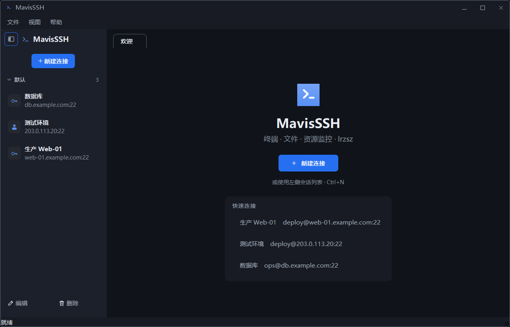
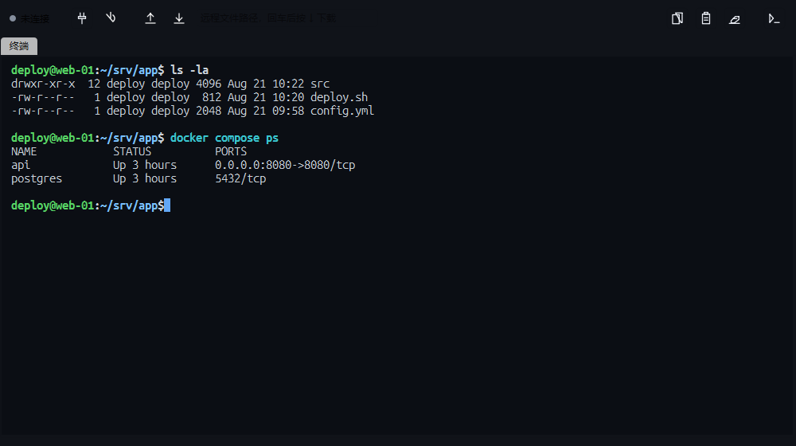
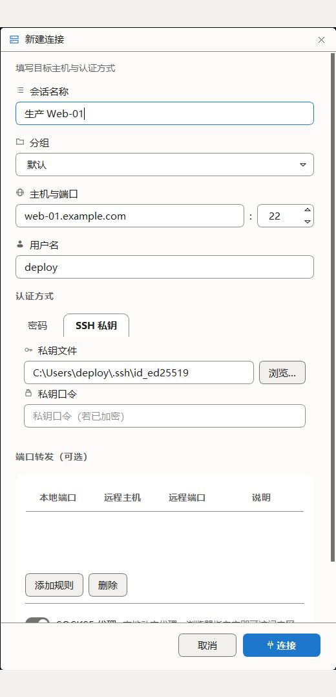
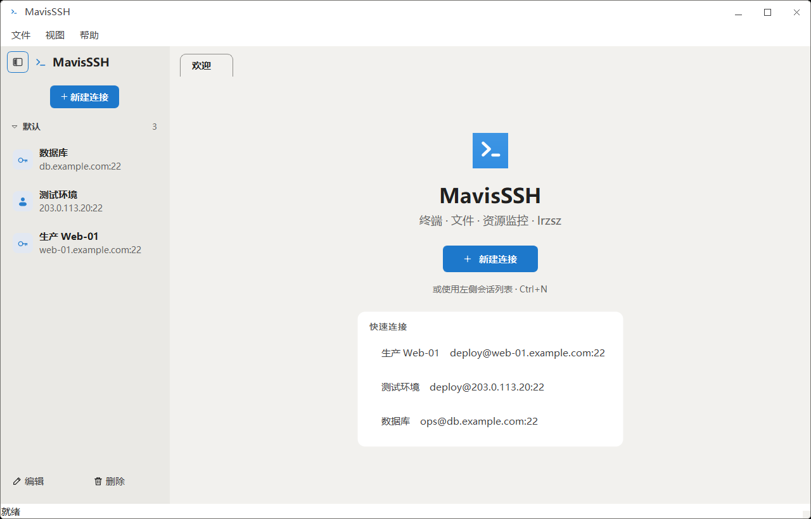

# MavisSSH

[](LICENSE)
[](https://www.python.org/)
[](https://pypi.org/project/PyQt6/)
[](#跨平台)

**一个用 Python + PyQt6 写的 Windows 桌面 SSH 客户端。**



- 🔐 **用户名 / 密码**与**SSH 私钥**（RSA / Ed25519 / ECDSA / DSS）认证
- 🖥️ **兼容 xterm 的终端**（基于 pyte，支持 ANSI / 256 色 / 光标控制）
- 🔀 **端口转发** —— 本地转发（`-L`）与 SOCKS5 代理（`-D`），带每条规则的实时连接数
- 📁 **SFTP 文件管理** —— 本地与远端并排，上传 / 下载
- 📊 **资源监控** —— CPU、内存、磁盘、网络、进程排行（经 SSH 轮询采集）
- 📤📥 **lrzsz / ZMODEM 传输**（rz / sz）—— 使用自带的 MSYS 二进制
- ⚡ **命令片段库** —— 常用远端命令点一下就插进命令行，**不自动回车**
- 🗂️ **会话分组** —— 可下拉选也可自由输入，分组段可折叠，标签标题为 `分组名-会话名`
- 📥 **从其他客户端导入连接** —— OpenSSH 配置 / PuTTY / WinSCP，**密码一律不导**
- 🎛️ **设置对话框** —— 主题、界面与终端字体、字号、回滚行数、轮询间隔
- 🌗 深色 / 浅色主题、可折叠侧边栏、会话持久化、多标签页
- 📦 可打包成 Windows 安装向导（NSIS），许可页展示 GPL-3.0

## 目录

- [快速开始](#快速开始)
- [功能一览](#功能一览)
- [界面](#界面)
- [使用 MiniMax Code 进行开发](#使用-minimax-code-进行开发)
- [开发](#开发)
- [打包成安装包](#打包成安装包)
- [测试](#测试)
- [安全](#安全)
- [许可](#许可)
- [贡献](#贡献)

## 快速开始

需要 **Python 3.10+**。一律使用项目内的虚拟环境 —— 应用不应依赖 `PATH` 上碰巧是哪个 Python。

```powershell
git clone https://github.com/AlbertD-byte/MavisSSH.git
cd MavisSSH
python -m venv .venv
.\.venv\Scripts\python.exe -m pip install -r requirements.txt
.\.venv\Scripts\python.exe main.py
```

macOS / Linux 下把路径换成 `./.venv/bin/python`：

```bash
git clone https://github.com/AlbertD-byte/MavisSSH.git
cd MavisSSH
python3 -m venv .venv
./.venv/bin/python -m pip install -r requirements.txt
./.venv/bin/python main.py
```

首次启动后，点左侧边栏的 **+ 新建连接**。

> 也可以直接下载 [Releases](https://github.com/AlbertD-byte/MavisSSH/releases) 里的 Windows 安装包，
> 双击即可安装，无需 Python 环境。

## 功能一览

| 能力 | 说明 |
|---|---|
| 认证 | 密码；SSH 私钥（RSA / Ed25519 / ECDSA / DSS），私钥口令单独填写 |
| 终端 | 基于 pyte 的 `HistoryScreen`，支持 ANSI / 256 色 / 光标控制、选区复制、滚动回看 |
| 补全 | `Tab` 原样转发给远端 shell；远端不响应时用 SFTP 目录列表兜底 |
| SFTP | 本地与远端并排浏览，上传 / 下载，后台线程传输，界面全程可操作 |
| 端口转发 | 本地转发（`-L`）与 SOCKS5（`-D`），每条规则显示实时连接数 |
| ZMODEM | lrzsz `rz` / `sz` 端到端传输，方向自动识别，附进度与速率 |
| 资源监控 | CPU / 内存 / 磁盘 / 网络 / 进程排行，按可配间隔轮询采集 |
| 命令片段 | 常用命令库，**只插入不执行**；内置危险命令自检 |
| 会话管理 | 分组、折叠、持久化、多标签页、快速连接 |
| 连接导入 | OpenSSH 配置 / PuTTY / WinSCP，**密码一律不导** |
| 主机密钥 | SHA-256 指纹确认，支持「信任一次」与「记住」 |
| 打包 | PyInstaller（目录版 / 单文件）+ NSIS 安装向导 |

## 界面

| | |
|---|---|
|  |  |
| **终端** —— 兼容 xterm 的多标签会话 | **新建连接** —— 认证方式、端口转发规则都在这里 |
|  |  |
| **深色主题** | **浅色主题** |

## 使用 MiniMax Code 进行开发

MavisSSH 的开发过程中使用了 **[MiniMax Code](https://agent.minimax.cn/)**（简称 MCode）——
MiniMax 的智能体编码工作台。这个仓库也是 **MCode 自身开发流程的一个实例**：
仓库根目录的 [`AGENTS.md`](AGENTS.md) 就是为此准备的。

### 仓库里的 MCode 约定

| 文件 | 作用 |
|---|---|
| [`AGENTS.md`](AGENTS.md) | **给编码智能体的项目规约**：行为准则、代码规范、日志规范、异常类型约定、提交规则。改动代码前请先读它。 |
| [`docs/ARCHITECTURE.md`](docs/ARCHITECTURE.md) | 设计决策、实测数据、否决过的方案。改动架构前请先读它。 |
| [`docs/FUNCTION-TEST-REPORT.md`](docs/FUNCTION-TEST-REPORT.md) | 按功能域逐项核对的结果清单。 |
| [`tests/_f*.py`](tests/) | **判据脚本**：每个都是独立可执行的自检套件，见下文「测试」。 |

`AGENTS.md` 里几条约定值得单独提出来，因为它们不是风格偏好，而是**踩过坑之后定下的**：

- **改动判据时钉性质，不钉字面量。** 断言「某个高度等于 50 px」会在字号一改就红，
  而产品并没有坏。判据该钉「旧样式下 tab 比控件高出一个内边距量」这种**关系**，
  不该钉某个会漂移的绝对值。
- **判据自己会出错。** 元断言要带元断言 —— 确认「把期望值挪动一格后判据必须会红」，
  否则一条恒绿的判据测不出任何东西。
- **批处理跑判据必须一个脚本一个进程。** 同进程里连着跑多个 Qt 脚本会互相污染，
  跑到第 6 个左右就访问冲突，而每个脚本单独跑都是绿的。
- **不自动提交。** 改完代码先报告改了什么，等人明确说了再 commit。

### 用 MCode 接手这个仓库

```bash
# 命令行
mcode
# 或者把仓库作为工作目录打开 MiniMax Code 桌面端
```

进入仓库后，MCode 会自动读取根目录的 `AGENTS.md` 并按其中的规约工作。

几个上手建议：

1. **先读 `AGENTS.md` 与 `docs/ARCHITECTURE.md`。** 前者是硬规则，后者解释了
   「为什么是这样」—— 很多看起来可以简化的地方，其实是被否掉的方案留下的坑。
2. **让 MCode 跑判据而不是自己判断。** 见下方「测试」一节的门禁命令；
   它会告诉你「红的是产品还是判据过期」。
3. **安全相关的改动要格外小心。** 这个项目处理 SSH 凭据、远端命令拼接与主机密钥，
   改动这几处前请读 [`docs/SECURITY_REVIEW_2026-10-20.md`](docs/SECURITY_REVIEW_2026-10-20.md)
   和 [`docs/SECURITY_FIX_PLAN.md`](docs/SECURITY_FIX_PLAN.md)，里面记着每一项的成因与回归点。

### 用别的工具开发

本仓库不绑定任何特定工具。判据全是**独立可执行的 Python 脚本**，不依赖 pytest，
所以任何工具链都能跑：

```bash
python _runall.py          # 跑全部门禁
python tests/_fconn.py     # 跑单套
```

## 开发

### 模块结构

包分成三层，依赖方向单向向内：`ui` 可以用 `core` 和 `remote`，反过来不行。
`core/` 不碰 paramiko / pyte，也就是不需要一台服务器就能测；其中只有 `fonts.py`
例外地需要 PyQt6，因为字体解析的输入就是 `QFontDatabase`。

| 组件 | 模块 | 职责 |
|---|---|---|
| **core/（不需要网络）** | | |
| 字体 | `sshclient/core/fonts.py` | 界面与终端字体的解析、策展清单、排除表、CJK 兜底 |
| 配置 | `sshclient/core/settings.py` | `SavedSession` 与 `AppSettings`，落盘为 JSON |
| 端口转发 | `sshclient/core/tunnel.py` | 规则校验、本地监听 socket、SOCKS5 握手与中继 |
| lrzsz | `sshclient/core/lrzsz.py` | ZMODEM 头部嗅探、本地 rz / sz 调用、字节级进度 |
| 命令片段 | `sshclient/core/snippets.py` | 片段库存储、内置只读命令集、危险命令自检 |
| 落盘加密 | `sshclient/core/crypto.py` | 会话敏感字段的逐字段加解密与密钥文件 |
| 连接导入 | `sshclient/core/importer.py` | 从 OpenSSH 配置 / PuTTY / WinSCP 读会话；**密码一律不导** |
| 日志 | `sshclient/core/logs.py` | 写当前工作目录下的 `logs/`，含轮转与脱敏 |
| **remote/（paramiko）** | | |
| SSH / SFTP 连接 | `sshclient/remote/connection.py` | 建连、认证、执行命令、SFTP 子系统 |
| 主机密钥 | `sshclient/remote/hostkeys.py` | 信任库管理（`~/.ssh/known_hosts` 只读 + 应用私有库读写）、指纹核对、「信任一次」与「记住并信任」 |
| **ui/design/（带版本的视觉层）** | | |
| 配色 v1 | `sshclient/ui/design/v1/palette.py` | `Palette` 深浅两套 token、ANSI/xterm256 表、颜色工具 |
| 皮肤 v1 | `sshclient/ui/design/v1/qss.py` | 整份 QSS。**与同目录的 `palette.py` 必须成对同版** —— 样式表里每条规则都消费同版字段，跨版混用会炸且界面上看不出异常 |
| **ui/（PyQt6）** | | |
| 窗口标题栏 | `sshclient/ui/titlebar.py` | 自绘标题栏、最小化/最大化/关闭、Windows 边缘缩放与贴边分屏（**仅 Windows**，macOS/Linux 保留原生边框） |
| 弹窗 | `sshclient/ui/msgbox.py` | 所有消息框 / 文件框 / 输入框的统一入口，保证每个弹窗顶上一条都是同一款自绘标题栏 |
| 标签关闭按钮 | `sshclient/ui/tab_close.py` | 自绘的标签页关闭按钮与几何控制。位置**永远由自己的 tab 决定**，不做安全区钳位 |
| 标签右键菜单 | `sshclient/ui/tab_context.py` | 标签页右键菜单（关闭当前 / 关闭其他 / 关闭右侧）。与关闭按钮共用 `tabCloseRequested` 一条路，保证两条路行为一致 |
| 标签滚动按钮 | `sshclient/ui/tab_scroll.py` | 溢出时给标签栏两端装的 `<` / `>` 滚动按钮 |
| 开关 | `sshclient/ui/switch.py` | SOCKS5 等布尔选项的开关控件与共享画法 |
| 窗口外框 | `sshclient/ui/window_frame.py` | 给无边框窗口自绘的一圈 1px 描边。**QSS 的 `border` 在这里画不出来**（central widget 满铺不透明，把边框盖光），且刻意不用 `accent`（用户可自定义，调成近白时对比度塌到 1.083、边框直接消失） |
| 终端 | `sshclient/ui/terminal_widget.py` | pyte 屏幕、按键处理、绘制、选区 |
| 主机密钥对话框 | `sshclient/ui/hostkey_dialog.py` | 首次见到主机 / 主机密钥变更时的确认框，展示 SHA-256 指纹 |
| 跨线程投递 | `sshclient/ui/thread_post.py` | 后台线程往界面投递的统一入口。投递前检查目标控件是否已被销毁 |
| 共用控件 | `sshclient/ui/controls.py` | 状态标签、图标按钮、竖分隔线 |
| 侧边栏 | `sshclient/ui/sidebar.py` | 会话行、折叠态的紧凑行、欢迎页、尺寸常量 |
| 主窗口与会话标签页 | `sshclient/ui/main_window.py` | 窗口骨架、菜单、`SessionTab`（工具栏 + 四个子页签） |
| SFTP 面板 | `sshclient/ui/sftp_panel.py` | 本地 / 远端目录树、传输 |
| 片段面板 | `sshclient/ui/snippet_panel.py` | 片段列表、搜索、增删改、**只插入不执行** |
| 传输编排 | `sshclient/ui/transfer_controller.py` | 一次会话只有一条状态条、忙时闸门、三种收尾 |
| 传输状态条 | `sshclient/ui/transfer_strip.py` | 底部进度条、字节/速率、完成与失败反馈 |
| 资源监控面板 | `sshclient/ui/monitor_panel.py` | 远端探测命令及其解析 |
| 转发面板 | `sshclient/ui/tunnel_panel.py` | 规则列表、增删、实时连接数 |
| 连接对话框 | `sshclient/ui/connect_dialog.py` | 新建 / 编辑已保存的会话 |
| 设置对话框 | `sshclient/ui/settings_dialog.py` | 设置页面与实时预览 |
| 图标 | `sshclient/ui/icons.py` | 用 `QPainter` 绘制的整套图标 |
| Logo | `sshclient/ui/logo.py` | 应用 Logo（`>_` 提示符）。**这里是 Logo 的唯一真相**，打包用的 PNG/ICO/ICNS 都由它导出 |

`SessionTab` 和 `MainWindow` 留在同一个文件里：它们互相持有，拆开只会把同一份
耦合换成一条 import 边。真正独立的侧边栏与共用控件已经拆出去了。

## 安装与运行

见上文[快速开始](#快速开始)。若已 clone 到本地：

```powershell
cd MavisSSH
python -m venv .venv
.\.venv\Scripts\python.exe -m pip install -r requirements.txt
.\.venv\Scripts\python.exe main.py
```

也可以用仓库自带的启动脚本，它会自动找到 `.venv` 里的解释器：

```powershell
python run.py
```

## 快捷键

| 快捷键 | 作用域 | 作用 |
|---|---|---|
| `Ctrl+N` | 窗口 | 新建连接 |
| `Ctrl+F4` | 窗口 | 关闭当前标签页（`QKeySequence.StandardKey.Close` 在 Windows 上就是这个键） |
| `Ctrl+,` | 窗口 | 打开设置 |
| `Ctrl+T` | 窗口 | 切换深色 / 浅色主题 |
| `Ctrl+B` | 窗口 | 折叠 / 展开侧边栏 |
| `Exit` | 窗口 | 退出（`QKeySequence.StandardKey.Quit`，在 Windows 上就长这样；macOS 上是 `Cmd+Q`） |
| `Ctrl+C` | 终端 | 有选区时复制，否则发送 `^C` 中断 |
| `Ctrl+Shift+C` | 终端 | 始终复制 |
| `Ctrl+V` | 终端 | 粘贴 |
| `Ctrl+Shift+V` | 终端 | 粘贴 |
| `Tab` / `Shift+Tab` | 终端 | 补全，见下文 |

`Ctrl+C` 是有意做成两用的：中断是 SSH 会话里最高频的按键，只有确实存在选区时才会被复制行为吃掉。**复制完选区会被清掉** —— 所以选中一段复制之后再按 `Ctrl+C`，发出去的是 `^C` 而不是又复制一遍。

## 侧边栏

按 `Ctrl+B` 或 **视图 → 折叠侧边栏** 可折叠成 **56 px 的图标栏**。图标栏保留与完整列表相同的控件 —— 认证徽标、连接状态（已连接时为绿点）、编辑与删除 —— 只省掉在这个宽度下读不了的东西。折叠状态保存在 `settings.json`。

## 设置

**设置**（`Ctrl+,`）分三页。按 **确定** 会把全部改动推给已打开的窗口并保存；**取消** 什么都不改。

| 页面 | 字段 |
|---|---|
| 外观 | 主题、界面字号（6–48 pt）、界面字体 |
| 终端 | 终端字体、终端字号（6–48 pt）、回滚行数（0–2 000 000 行）、显示全部字体 |
| 监控 | 刷新间隔（100–600 000 ms） |

这四段范围**直接取自 `AppSettings._INT_RANGE`**，设置框不再自己抄一份 ——
抄两份就等于有两道闸，而它们一度并不一致（设置框当时只让填 8–18 pt，
而程序本身接受 6–48 pt，于是用户手填不出一个合法的 24 pt）。

**界面**字体与字号在选择过程中会实时作用到整个窗口 —— 它就是应用字体，改动会重排所有控件，取消时会把原先的字体装回去。**终端**字体只在对话框内的样例行上预览，点 **确定** 才会推给已打开的标签页。

两个字体选择器都默认停在 **自动选择**，含义是"本机实际装有的第一个可用字体"，而不是写死某个名字。已保存但后来被卸载的字体仍会留在列表里并标注 **（当前不可用）**，绝不静默丢弃这个值。

## 文件管理（SFTP）

左侧本地、右侧远端。选中文件后点中间的 **上传** / **下载** 即可；两边的
路径栏可以直接输入路径回车，工具栏有上一级、刷新、新建目录和删除。

传输跑在后台线程上，**界面全程可操作**。面板底部会出现一条状态条：图标、
文件名、已传/总量和速率、一条圆角进度条。空闲时它整个收起，不占地方；
传完显示片刻绿色"完成"就自己退场。

多选时是**一批一个进度条、按顺序传**，小字会显示 `2/3 · 文件名`。
首次收到数据前进度条走一条来回滑的亮带 —— 点上传到服务器回第一个字节之间
可能隔好几秒，一个卡在 0% 的条子看起来像死了。

失败**不弹框**：状态条转成红色并停在那里等你点关闭（完整原因放在悬停提示
里）。一次失败没人看见等于没报，而模态框会抢走焦点、盖住文件列表。

两点要提前知道：

- **目录不递归。** 选中目录会被跳过，完成提示里会列出跳过了哪些。
- **"取消"止不住已经发出去的那一个文件。** 它只停掉后续文件、关掉状态条；
  底层没有中途放弃一个上传的接口，硬做会留下半个文件。取消后状态条显示
  灰色的"已取消"——没传完就是没传完，不会报成"完成"。

> 远端列表刷新同样在后台线程取数。传输期间点刷新不会卡界面，但也拿不到
> 新结果 —— 一个 SFTP 通道同一时刻只能有一个操作在进行。详见
> `docs/ARCHITECTURE.md`。

## 端口转发

每条规则是 **本地端口转发（`-L`）** 或 **动态 SOCKS5 代理（`-D`）**。面板列出每条规则的本地端口、目标、实时连接数与开关；规则随会话一起保存，重开会话会把隧道带回来。

**同一个本地端口被别的会话占着时，会自动往后顺延。** 两条会话都按惯例写 13306 指向各自那台库（生产 / 预发）是最常见的用法，原来后连的那条直接绑不上——规则在界面上显示"开"，实际一个端口都没监听，还没有任何提示说清是谁占了。现在它会改到 13307 并**把这个号存回磁盘**（否则下次打开看到的还是 13306，而实际听的是 13307），同时在状态条上说明改到了哪里。一条规则最多往后试 20 个端口，全被占就如实报错，不会静默改到一个离谱的号。

同一个会话内的重复端口仍然直接报"已被占用"——那是配错了，不该被自动"修好"。

开关不直接写模型：它先问连接层，成功之后才刷新表格。因此端口被占用导致开启失败时，开关会弹回"关"，而不会显示成已开启。

> 每条规则自绑自己的本地监听 socket，而不是共用 `paramiko.Transport.accept()` —— 后者把所有转发塞进同一个队列，且返回 channel 的 `getpeername()` 给出的是**主连接**地址而非本地监听端口，无法反查命中的是哪条规则。详见 `docs/ARCHITECTURE.md`。

## lrzsz 配置

### 本地工具

**Windows：** `bin/rz.exe` 与 `bin/sz.exe`（来自
[trzsz/lrzsz-win32](https://github.com/trzsz/lrzsz-win32) 发布版，基于 MSYS）
已随仓库附带，所需的 `msys-2.0.dll` 也在其中。Python 模块 `sshclient.core.lrzsz`
会自动找到它们。若偏好 GNU 命名（`lrz` / `lsz`），把 `bin/` 里的二进制改名即可，
解析器两种都认。

**macOS / Linux：** 仓库里那两个是 **Windows PE 可执行文件**，在别的系统上跑不了，
解析器也会主动绕开它们（POSIX 上不认 `.exe` 后缀）。请用系统包管理器装：

```bash
# Debian / Ubuntu
sudo apt install lrzsz
# CentOS / RHEL / Fedora
sudo yum install lrzsz      # 或 dnf install lrzsz
# macOS
brew install lrzsz
```

装完 `lrz` / `lsz` 就在 `PATH` 上，解析器第 3 步会找到它；找不到时面板会直接
告诉你缺哪个二进制，而不是静默失败。

### 远端主机

远端按常规方式安装 `lrzsz`：

```bash
# Debian / Ubuntu
sudo apt install lrzsz
# CentOS / RHEL
sudo yum install lrzsz
```

**没装也能用。** 点工具栏的上传/下载时，程序会先探一次远端有没有 `sz` / `rz`；
没探测到就弹框告诉你怎么装，并让你在「改用 SFTP 传输」和「先不传」之间选 ——
选 SFTP 就直接把这次传输做完（上传落到当前 shell 所在目录，下载落到本地下载目录），
和 ZMODEM 的语义对齐。探测本身只在第一次问，之后按标签缓存，重连时重新问。

在终端里自己敲 `sz` / `rz` 不走这套检查——你能敲下去，说明远端本来就有。

### 用法

远端命令与本地工具方向**永远相反** —— `rz` 负责接收，所以本地必须是发送方 `sz`，反之亦然：

| 动作 | 远端命令 | 本地进程 | 原因 |
|---|---|---|---|
| 上传（Windows → Linux） | `rz` | **`sz.exe`** | 远端接收，我们发送 |
| 下载（Linux → Windows） | `sz <file>` | **`rz.exe`** | 远端发送，我们接收 |

- **上传（Windows → Linux）：**
  在会话标签页的工具栏点 **上传文件到远程 (rz)** 并选择文件（**可以多选**）。
  应用向远端 shell 发送 `rz`，等它发出 ZRQINIT 头，然后在本地运行 `sz.exe`。
  文件落到远端当前目录。

- **下载（Linux → Windows）：**
  在 **ZMODEM** 输入框里填远端路径，点 **Download (sz)**。应用发送 `sz <路径…>`，
  稍作延时后启动 `rz.exe` —— 远端发送方正在等我们的 ZRINIT，所以接收方必须先开口。
  文件落到本地当前目录。
  输入框**可以写多个路径**，按 shell 的规矩用空格分开，带空格的路径用引号包住：
  `a.log "my file.txt" /var/log/syslog`。**引号会重新加回**——只剥不还原的话，
  远端会把 `"my file.txt"` 当成两个文件名。

  路径传给远端时**逐个加引号，不会有第二个路径混进来**：以 `~` 开头的路径由
  远端自己用 `${HOME}` 展开，其余部分原样当文件名。所以路径里带 `;` `|` `>`
  这些字符时，它们是**文件名的一部分**，不会被远端 shell 当成命令分隔符。

> 下载方向的进度条是**不定态**（一条滑动的亮带 + 已收字节数），拿不到百分比：
> 远端文件有多大我们不知道，编一个数字比"不知道"更糟。

- **纯终端流程：** 在终端里直接敲 `rz` 或 `sz <文件>`，**方向按你敲的命令自动定，
  不弹框**：
  - `sz a.log` → 直接开始下载，远端路径就从这条命令里取（带空格、引号都照 shell
    规矩拆）；只敲 `sz` 不带参数时才会问一次"要下哪几个"，因为远端那侧在交互地
    问文件名，而传输期间终端输入是被封着的；
  - `rz` → 接着问「选择要上传的文件」，与点工具栏上传按钮同一条路（本地有哪些要
    发只有你知道，这一步省不掉，省掉的只是方向那一次问）。

  **认不出时才问。** `rz`（远端收）和 `sz`（远端发）发的是**同一个** ZRQINIT 头
  （`**␘B0`），字节上分不出方向 —— 但你刚敲的那条命令**就印在终端上**，所以程序
  从屏幕往上回看最多 8 行去找它。三道防误认：帧头的 `**` 之前才算命令（lrzsz 自己
  的提示和帧头都被这一刀排除）；离光标最近的那条赢；带提示符的那行赢裸行 ——
  `sz` 等不到回应时 lrzsz 会打一句 `rz␘B0100…` 提醒"该起 rz 了"，光看裸行会把一次
  下载说成上传。提示符被自定义成认不出的样子、或传输是被脚本 / 别名触发的，就
  **仍然问一次**（上传 / 下载 / 取消），取消会给远端送一个 `Ctrl-C`，把它从 raw
  模式里拽出来。

  以前这里是两处静默失效：敲 `sz` 会被当成上传，起一个本地 `sz` 往远端**发**，
  而远端也在等**发**，两个发送方对着干；敲 `rz` 则被一句方向守卫挡回去，**终端里
  敲了之后什么都不发生**。

- **进度与结果：** 两种方式都报在同一条状态条上（在会话底部，不是文件面板里），
  含已传 / 总量 / 速度，以及"正在传第几个"。**同一时间只允许一个传输**——再点一次
  不会开始，也不会弹框打断你，状态条就停在那儿告诉你还在传。

> **一次只能传同一个目录下的文件。** 选中了跨目录的文件时，只有第一个文件所在目录的
> 那些会被发送，其余会在状态条上如实标为"已跳过"。原因在协议：远端只有一次 `rz` 在等，
> 而 `sz` 送完自己那批就退出了。

## 命令片段库

工具栏最右的 `>_` 图标（或按它）打开一个非模态小窗，里面是一组常用远端命令。
选中一条按 **插入**、双击、或在搜索框里按回车，命令会**写进远端当前的输入行**。

> **只插入，绝不自动回车。** 插进去之后远端还没执行，你还能退格、Ctrl+U、Ctrl+C。
> 这是这个功能唯一不可让步的一条：加一个 `\r` 进去，"我想看看这条命令会干什么"
> 就变成了"它已经干了"。

- **不清行。** 本地不知道远端行缓冲的真实内容（readline 补全过的、带多字节宽字符的），
  硬猜着发退格键只会删错字符。想换一条命令请自己按 `Ctrl+U`，面板底部一直写着这句。
- **不抢焦点。** 叫出面板时键盘焦点**留在终端上**，你可以一边看着它一边继续敲命令。
  真去点搜索框或列表时焦点才过去，而那时按回车走的是面板自己的槽。
  `Esc` 先清空搜索词，再按才关窗 —— 任何情况下都不会有一个字节漏给远端。
- **传输期间整块禁用。** ZMODEM 跑的时候通道被 `sz`/`rz` 占着，这时候插进去的字符
  会被当成传输载荷。注意**禁用的起点比"进度条开始跑"更早**：下载方向上按下按钮后
  `sz` 命令已经发出、本地接收端还要等半秒才起，那半秒里同样不能插；上传方向等
  对端握手的窗口则没有上限。
- **命令里不能有换行，也不能有看不见的字符。** 粘贴一段多行命令进来是会被
  **拒绝**的（标题和命令两栏都填了也点不动添加）。原因是插入是逐字节原样发
  出去的，命令里一个换行就等于替你按了回车，把后半截执行掉。首尾的空白和
  换行照常忽略 —— 危险的是中间那个。
  零宽字符和 **U+202E**（右到左覆盖）同样拒收：U+202E 能让 `rm -rf /tmp/x`
  在界面上显示成完全不同的样子，而双击执行的是屏幕上那串字符。

内置集是十条只读、不需要参数的常用命令（`df -h`、`free -h`、`ss -tulpn`、
`journalctl -n 100 --no-pager` …），每条都注明它回答什么问题。**没有一条是破坏性的**：
`tests/_snippets.py` 会往内置表里塞 19 种危险写法回去，证明自检真的会报出来
——否则一个什么都不检查的函数和这个检查长得一模一样；同时也要验**正常命令不被
误伤**。不想要的内置条目可以删掉，**恢复内置**会把删掉的补回来，你自己加的不受影响。

危险写法要覆盖的不只是 `rm -rf` 本身，还有**藏在包装词后面**的那些：
`sudo rm`、`env rm`、`time rm`、`busybox rm`、`FOO=1 rm`、`ls | xargs rm`、
`mkfs.ext4`、以及 `awk '{system("rm -rf /")}'`、`python -c "os.system('rm -rf /')"`、
`cleanup() { rm -rf …; }` 这种根本不经过"第一个词"这条路的。甚至选项本身也是
陷阱：`sudo -n`（不带值的选项）、`sudo --`（终止符）、`nice -n5`（附着式）后面
跟着的 `rm` 都要抓得到。自检会先剥掉包装词链
再找刀，也会把解释器里的载荷抽出来复查。

**增删改。** 底部两栏既能新增，也能**改**：选中一条按 **编辑**，标题和命令会装进
输入框，「添加」变成「保存」。改完 id 不变、条数不变，所以选中项不会跳走，内置
条目也可以改。编辑期间列表是锁着的 —— 不锁的话「保存」改的到底是哪条要看当时
选中了什么；**退出编辑的每一条路都会解锁**——「保存」「取消」，以及关窗和隐藏
（收起再叫出面板时不会停在编辑态，这一点最容易漏：`main_window` 复用同一个
面板实例，只堵按钮的话这时在命令框按回车会**静默覆盖**原来那条）。

片段存在 `%APPDATA%\MavisSSH\snippets.json`（macOS/Linux 见下方对照表），
**和会话文件分开**：会话文件带口令密文，两种生命周期不同的数据不该绑在一起。
读不出来时（编码不对、不是 JSON、手工编辑截断）它会退回内置集并提示一声，
**同时把原文件改名留成 `snippets.json.bad-1`** —— 不是删掉，也不是留在原地等
下一次保存覆盖掉。原字节还在，你救得回来。

## 终端相关的说明

- 终端基于 pyte 的 `HistoryScreen`，能理解绝大多数 xterm 转义序列（颜色、光标、擦除、滚动）。
- 鼠标滚轮向上翻历史；按住拖动可选中文本；工具栏有 **复制** / **粘贴** 按钮。
- 窗口尺寸变化会同步到远端 PTY（列数 × 行数）。拖动窗口边时做了节流，
  最多每 80 ms 发一次 window-change；断开之后不再发。
- 会话工具栏的 `重新连接` 用已保存的配置重新建连。

### 字体

终端字体与界面字体分开设置 —— 界面**故意不用**等宽体，否则每个标签和按钮都像代码编辑器。

- **终端：** 首选字体之后接一个已安装的 CJK 兜底字体（**黑体**优先）。度量（因而也是列网格）
  只取自首选字体，所以增加兜底不会扰动西文渲染 —— 这一点由 `_glyphfb.py` 逐字节断言。
  Qt 本来就会自己补字，但它挑的是**宋体**；衬线的宋体挂在终端的无衬线拉丁旁边明显不对路，
  所以兜底字体是**指名**的，而不是继承来的。
- **终端字体列表：** 选择器只提供等宽字体族，并剔除那些不适合终端的 —— 中文印刷体与书法体、
  DOS 时代的点阵字体，以及 `SimSun-ExtB` / `SimSun-ExtG`：后两者虽是固定字宽、也能通过
  等宽交叉检查，但只覆盖补充区码位。勾选 **显示全部字体** 可把它们全部拿回来；
  无论勾不勾，本机字体都不会被卸载。
- **界面字体：** 是一份精选清单，而不是把已装字体全列出来 —— 本机报告有 400 多个字体族，
  其中大多数是展示字体。

### Tab 补全

补全归**远端** shell 所有，应用从不与之相争：`Tab` 原样转发，bash/zsh 的 readline
在任何终端里的行为都保持一致。

| 按键 | 发给远端 | 效果 |
|---|---|---|
| `Tab` | `\t` | 补全（再按一次列出候选） |
| `Shift+Tab` | `ESC [ Z` | 在候选间循环 |
| `Ctrl+← / →` | `ESC [ 1;5D` / `C` | 按词移动 |
| `Alt+← / →`、`Alt+B / F` | `ESC [ 1;3D` / `ESC b` | 按词移动 |
| `Ctrl+Backspace` | `\x08` | 删除前一个词 |
| `Ctrl+Home / End` | `ESC [ 1;5H` / `F` | 行首 / 行尾 |

**兜底。** 若远端 300 ms 内没有响应 —— busybox `sh`、不理会 `Tab` 的命令、解析不出来的提示符 ——
应用改用 SFTP 目录列表自行补全。补全是**敲进去的**（退格若干次再送出补全后的词），而不是重绘，
因此远端的行编辑器始终是权威，在任何 shell 上看起来结果都一样。

- 唯一匹配 → 补全，目录补一个尾部 `/`
- 多个匹配 → 插入公共前缀，其余进状态栏
- 无匹配 → 保持原样，状态栏给出提示

当前目录取自 `user@host:/path$` 提示符，所以跟着 `cd` 走也不会错。远端路径一律用
`posixpath` 处理，因此 `/etc/hosts` 这类绝对路径在 Windows 上也能正确补全。

> `TerminalWidget` 覆写了 `event()`，在 Qt 之前抢下 `Tab` / `Shift+Tab`。`QWidget::event()`
> 默认会把这两个键花在 `focusNextPrevChild()` 上；会话工具栏（若干按钮和 ZMODEM 路径输入框）
> 都在焦点链里，于是 `Tab` 会跳到下一个控件而不是补全。现在只要终端有焦点，`Tab` 就归终端；
> 工具栏照旧用鼠标或 `Ctrl+Tab` 一类的方式切换。

## 资源监控相关的说明

- 每 N 秒（默认 2 秒）轮询一次远端，用一条 bash 探测命令输出带 `##SECTION##` 标记的文本，
  再解析。适用于任何带 `top`、`free`、`df`、`ps`、`/proc/net/dev` 的 Linux/macOS 主机。
- 轮询间隔同样在 **设置 → 监控** 里，已打开的监控面板与新建的都会跟着变。

## 会话与配置的保存

会话与偏好保存在：

- **Windows：** `%APPDATA%\MavisSSH\`
- **macOS：** `~/Library/Application Support/MavisSSH/`
- **Linux：** `~/.config/MavisSSH/`

`settings.json` 以 `utf-8-sig` 读取：BOM 不能被读成"全是默认值"，因为 BOM 加上启动即写回，
足以把真实设置覆盖成默认值。写入走临时文件加原子替换，因此写到一半中断也不会把你在意的
那个文件截断。

`sessions.json` 里的**主机、端口、账号、密码、私钥路径与私钥口令逐字段加密**，
密文带 `enc:v1:` 前缀，密钥是配置目录下的 `secret.key`。`name`、`notes`、`id`、
`group` 和 `tunnels` 保持明文，所以这个文件仍然可以直接打开看懂。

> **这个方案防的是什么、不防什么**：密钥文件和数据文件在同一个用户账户下，
> 所以它防的是"随手打开 `sessions.json` 就看到明文密码"，
> **不防**同账户下的其他进程。要防后者得换成系统钥匙串（Windows DPAPI）。
> 取舍见 [`docs/ARCHITECTURE.md`](docs/ARCHITECTURE.md)。

`secret.key` 现在就是数据的全部，**请把它一起备份**；丢了就读不回来。
遇到这种情况应用不会把会话当空列表糊过去，而是保留原文件、拒绝写入，
你把密钥放回去重启一次即可恢复。

升级前已有的明文 `sessions.json` 不需要迁移：读的时候照常认得，
**下一次保存时自动转成密文**。

## 会话分组

同一个人的服务器常常分好几批：生产的、测试的、自己那台开发机。新建或编辑
连接时，**会话名称**下面多了一个 **分组** 输入框 —— 它是一个**可以下拉选、
也可以直接打字**的框：

- 下拉里列着**已经存在的分组**，点一个就把这条会话归进去；
- 列表里没有你想要的，直接打字，保存会话时这个新名字就成了一个分组；
- 选 **默认** 表示这条会话不归任何分组。

侧栏按分组分段显示，每段前面有一行分组标题，右边是这一段里的会话数。
**没有分组的会话归到「默认」这一段**，排在最后 —— 空分组是「还没整理」，
有名字的是「整理过了」，新连接默认落在最后那段，不会插进你已经维护好的
分组中间去。

**点一下分组标题就能折叠/展开整段**，箭头 `▾` / `▸` 指示当前状态。
折起来之后标题行仍然留着（会话数还在），可以随时点回去；折叠状态会记进
配置，下次打开还在。侧栏自己收成 56 px 图标栏**不会**清掉它。
折叠掉的如果正好是当前选中会话所在的那一段，选中会跟着消失 —— 那一行
已经不在列表里了，不是误伤；展开回来点一下那条会话即可。

标签页上的标题是 **`分组名-会话名`**（例如 `生产-Web-01`），不再是
`用户名@ip:端口`。两者的分工是：标签回答**哪一个**，
状态栏右侧那个 pill 回答**在哪里**（它一直显示 `用户名@主机:端口`，断线即清空）。
地址没有丢，它还在侧栏那一行里。

几条边界：

- **分组名排序按 Unicode 码位**（`测试` 在 `生产` 前）。中文没有字典序，
  拼音排序要一张多音字表，而「生产」和「长宁」的拼音首字母给不出稳定结果 ——
  码位是唯一能做到人人复现的那一种。**「默认」不参与排序，永远排最后。**
- **「默认」只是显示名**。磁盘上没分组仍然是空串，所以升级/降级都不会凭空
  多出一个叫「默认」的真分组。代价是：你自己新建一个正好叫「默认」的分组，
  会和默认分组合并成同一个 —— 这是故意的，界面上只该有一个「默认」。
- **默认分组只影响侧栏，不影响标签标题**：没分组的会话标签仍然只是
  `Web-01`，不会被写成 `默认-Web-01`。侧栏答「它归在哪」，标签答「它是哪个」。
- **折叠成 56 px 图标栏时不画分组标题**：那个宽度只放得下一个 40 px 的方块。
- **分组标题行不可选中**（但可以点它折叠），右键它不会弹出菜单。
- 老会话读进来就是未分组，会落在「默认」那一段，不会被凭空塞进别的分组。

## 从其他终端导入连接

**文件 → 从其他终端导入…**（在「新建连接…」下一项，**没有快捷键**）。程序会
自己探测常见位置，把找到的连接列成一个多选清单，**默认全勾**，确定后并进
会话列表。

| 来源 | 读的是哪里 |
|---|---|
| OpenSSH 配置 | `~/.ssh/config`（**优先读它**，纯文本、跨平台） |
| PuTTY | 注册表 `HKCU\Software\SimonTatham\PuTTY\Sessions` |
| WinSCP | 注册表 `HKCU\Software\Martin Prikryl\WinSCP 2\Sessions` |

PuTTY 与 WinSCP 共用一个解析器：两者同出一份 PuTTY 代码血统，会话字段
（`HostName` / `PortNumber` / `UserName` / `PublicKeyFile`）完全一致，只有判协议
用的那个字段不同。**注册表来源只在 Windows 上存在**——macOS / Linux 上
自动只剩 OpenSSH 配置一条。

几条边界，都是有意这么定的：

- **密码一律不导，这不是省事，是搬不动。** PuTTY/WinSCP 压根不存密码；Xshell
  用 DPAPI 或 Master Password；MobaXterm 是 AES + 本机 Windows 凭据；
  FinalShell 是 DES/AES。**没有一个能跨机解密**，而去逆向别家客户端的密码
  加密在合规上也不干净。所以导入的上限是 **主机 + 端口 + 用户名 + 私钥路径**，
  导进来的会话一律是密码登录，第一次连时填一次。
- **`.ppk` 不能当私钥用。** PuTTY/WinSCP 的 `PublicKeyFile` 指向 `.ppk`，
  那是 PuTTY 自己的格式，paramiko 读不了。遇到它**不写进 `key_filename`**——
  填一个读不了的路径比留空更糟（界面上显示「密钥登录」，一点就报错），
  改为留空 + 在备注里写明。
- **判重按 `(主机, 端口, 用户名)`，不按名字。** 同一个服务器存两遍对用户没有
  好处，而用户真正在意的恰恰是「别重复」。重复的会如实报「跳过 N 条」。
- **一个来源都没找到时说清楚查了哪儿**，而不是静悄悄地导入 0 条：这些客户端
  几乎都允许改配置路径，猜错一个位置就什么都读不到。

## 日志

应用日志写在**当前工作目录**的 `logs/mavisssh.log`，单个 2 MB、留 5 个历史。
从别的目录启动就会写到那个目录下面，所以启动第一行会把实际路径打进日志。

若当前目录写不进去（最典型的是 macOS 从 `.app` 双击启动，此时 CWD 是 `/`），
会依次退到**配置目录**、再退到系统临时目录，而不是直接崩掉——那行代码抛在
`QApplication` 建好之前，一旦抛异常就是整个应用起不来。

连接成功 / 失败 / 断开、认证方式、主机指纹、以及未捕获的异常（原先那个
`~/.mavisssh/crash.log` 已并入这里）都会记。**密码和私钥口令不会进日志**——
这条由 `tests/_logs.py` 真连一次失败的连接来验证，不是只测一个脱敏函数。

## 跨平台

应用本身在 Windows / macOS / Linux 上都能跑。平台差异集中在三处，都已显式处理：

| 位置 | Windows | macOS / Linux |
|---|---|---|
| 配置与密钥 | `%APPDATA%\MavisSSH\` | `~/Library/Application Support/MavisSSH/`、`~/.config/MavisSSH/` |
| 命令片段 | `%APPDATA%\MavisSSH\snippets.json` | 同上目录下的 `snippets.json` |
| 本地 rz/sz | 仓库自带的 `bin/rz.exe` | 系统包管理器装 `lrzsz`，从 `PATH` 找 |
| CJK 兜底字体 | 黑体 / SimHei | PingFang / Hiragino（macOS）、Noto CJK / 文泉驿（Linux） |

`tests/_portable.py` 专门守这些地方——因为它们坏掉时**不报错**，只是功能悄悄没了
（在 mac/Linux 上字体目录找不到，`QFontDatabase.families()` 返回 0，于是**所有**
截图断言变成恒真；CJK 兜底表若只有 Windows 字体，缺字兜底直接失效）。

## 打包成安装包

`installer/` 下是三平台共用的打包配置：

```console
python -m pip install -r requirements-build.txt
python installer\build.py            # 当前平台的默认产物
python installer\build.py --clean    # 先清 dist/ 和 build/
python installer\build.py --onefile  # 单文件（启动慢，见下）
python installer\build.py --onefile --nsis   # 顺带打 Windows 安装向导
python installer\build.py --runtime-check   # 构建完再跑一遍端到端验收
```

| 平台 | 产物 | 位置 |
|---|---|---|
| Windows | `MavisSSH\MavisSSH.exe` + 依赖 | `dist/` |
| macOS | `MavisSSH.app` | `dist/` |
| Linux | `MavisSSH\MavisSSH` + 依赖 | `dist/` |

**不能在一台机器上打三个平台的包。** PyInstaller 打进的是本平台的二进制格式
（Windows PE / Mach-O / ELF），换系统就跑不了。所以这三份**必须在三个系统上
各打一次**；要自动化就上 CI 的 matrix。

### ⚠ 目录版的 exe 不能单独拷走

`dist\MavisSSH\MavisSSH.exe` **不是**自包含的可执行文件。Qt 的 DLL、平台插件、
翻译文件，以及 lrzsz 的 `bin\rz.exe` / `bin\sz.exe` 全在**同目录的 `_internal\`**
里。只把 exe 拷到别处启动，Windows 会弹一个系统的 `Error` 对话框（缺 DLL），
进程活着但没有窗口——用户看到的就是「窗口一闪就没 / 缺依赖」，而打包过程一路
绿灯、不报任何错。

分发时**整个 `MavisSSH\` 目录一起拷**。要单个 exe 就加 `--onefile`：

| 产物 | 能否单独拷走 | 首个窗口（实测） |
|---|---|---|
| `dist\MavisSSH\`（目录版，默认） | ❌ 整个目录才行 | 1.3s |
| `dist\MavisSSH.exe`（`--onefile`，约 45MB） | ✅ 随处可放 | 3.1s |

`--onefile` 之前是**空转**的：spec 里写死了 `COLLECT`，命令行传的 `--onefile`
不会把它拆成「二进制全塞进 EXE」。现在改成由环境变量 `MAVISSSH_ONEFILE` 分支，
spec 和 `build.py` 两处必须同时改，只改一边会打出一个「界面能起来但功能全缺」
的包。

### Windows 安装向导（NSIS）

```console
python installer\build.py --onefile --nsis
```

需要系统已装 [NSIS](https://nsis.sourceforge.io/) 且 `makensis` 在 `PATH` 上
（脚本还会去 `%ProgramFiles(x86)%\NSIS` 之类的地方找一遍；找不到就**跳过安装包
这一步并打印下载链接**，而不是甩一屏 traceback）。产物是
`dist\MavisSSH-<版本>-Setup.exe`。

- **按用户安装**，默认落在 `%LOCALAPPDATA%\Programs\MavisSSH`，不弹 UAC。
  代价是没有「为所有用户安装」——要的话把 `RequestExecutionLevel` 改成 `admin`、
  `InstallDir` 改成 `$PROGRAMFILES`。
- **包的是 `--onefile` 那个 exe，不是目录版。** 目录版要几千条 `[Files]`，
  装得慢、卸不干净、取消一次还留半个目录；单文件只有一条 `[Files]`，
  「取消」就等于「什么都没装」。
- **向导有一页展示 GPL-3.0 全文**（`MUI_PAGE_LICENSE "..\LICENSE"`），用户点同意
  才能继续。这满足的是 GPL 第 4 条「给每位接收者一份协议副本」；同时 `LICENSE`、
  `LICENSES/*.txt` 与 `THIRD_PARTY_NOTICES.md` 会落到安装目录，装完仍然能查到。
- **版本号有两份手抄的**：`installer/mavisssh.nsi` 的 `APP_VERSION` 与
  `sshclient/__init__.py` 的 `__version__`，打包器不读 Python 源码，改一处
  不会自动同步另一处。
- 桌面快捷方式是一个**可选组件**，不勾就没有。

### 验收产物

```console
python installer\verify.py           # 静态：产物自包含吗
python installer\verify_runtime.py    # 端到端：真跑起来、整目录挪位置再跑
```

`verify.py` 在每次构建后自动跑。两者都量「用户真正会遇到的事」：只拷 exe 会不会
起不来、整个目录换个位置还能不能跑、`_internal\bin\sz.exe` / `rz.exe` 是不是真
能执行（**静态存在 ≠ 能跑**，它们是 MSYS2 程序，还依赖 `msys-2.0.dll`）。

图标不用手改：`sshclient/ui/logo.py` 是 Logo 的唯一真相，`python
installer\make_icons.py` 从它导出全套 PNG / `.ico` / `.icns`（构建时缺了会
自动生成）。

## 测试

全部是独立可执行的脚本，放在 `tests/` 包下 —— 不引入 pytest，因此在没配开发环境的机器上也能复跑。

用仓库自带的环境跑（`python` 指向 `.venv` 里那个）：

```console
python _runall.py
```

每套脚本有独立进程和独立的 180 秒期限：某个脚本卡住时，报错只落在它身上，而不会卡住整轮。
每套脚本也都能单独跑：

```console
python tests\_crypto.py
```

只做**测量**的脚本 —— `_fontcheck.py`、`_bench.py`、`_shots.py` —— 刻意**不进**这一轮。

### 真机联调

`tests/_live.py` 是唯一一个**对着真服务器跑**的脚本，其余全套都是离线的。它验的是
离线那一套永远验不到的东西：真实 PTY 的尺寸同步、真 SFTP 的逐字节一致性、真
lrzsz 的端到端、真隧道转发。

连接信息**只从环境变量读**，不落盘、不写进 `sessions.json`：

```console
MAVIS_LIVE_HOST=localhost MAVIS_LIVE_USER=<用户名> MAVIS_LIVE_PASSWORD=<密码> python tests/_live.py
```

Windows PowerShell 写成三行：

```powershell
$env:MAVIS_LIVE_HOST="localhost"
$env:MAVIS_LIVE_USER="<用户名>"
$env:MAVIS_LIVE_PASSWORD="..."
.\.venv\Scripts\python.exe tests\_live.py
```

没给 `MAVIS_LIVE_USER` / `MAVIS_LIVE_PASSWORD` 就 `exit 2`（跳过）——
**「没测」和「测过了」在退出码上分得开**。

**故意不接进 `_runall.py`**：它依赖一台外部服务器，塞进离线回归的门禁里，
网络抖一下就把门禁弄红。跑它要单独跑，这是有意的取舍。

远端需要装 `lrzsz`（`sz` / `rz` 在 `PATH` 里），ZMODEM 那两节才跑得动；
没装会明确跳过而不是假装通过。
它们必须跑在真实的 `windows` 平台插件下：在 `QT_QPA_PLATFORM=offscreen` 下 Qt 根本找不到
字体目录，`QFontDatabase.families()` 返回 0，它们的数字就成了虚构。

字体辅助代码在 `tests/fonts.py`，同样在 `sshclient/` 之外：`boot()` 一被导入就会改
进程级的 `QT_QPA_PLATFORM`，这种副作用不该由发布包里的任何模块携带。

每个脚本在 import 项目代码前都会自己把**项目根**加进 `sys.path`（脚本在 `tests/` 下，
而 `sshclient` 在它的上一级），所以从任何工作目录跑都可以，仓库换个位置也不会失效。

设计决策、背后的坑、以及目前仍未真机验证的部分，见
[`docs/ARCHITECTURE.md`](docs/ARCHITECTURE.md)。

## 安全

**发现安全问题，请不要开公开 Issue。** 按 [`SECURITY.md`](SECURITY.md) 的流程私下报告。

### 这个项目在防什么

| 面 | 状态 |
|---|---|
| 中间人冒充服务器 | **主机密钥校验做成真实流程**：显示 SHA-256 指纹，可「信任一次」、可「记住并信任」，已信任主机可管理。拒绝即断连 |
| 远端命令注入 | lrzsz 路径**逐个加引号**，`~` 交由远端 `${HOME}` 展开；`conn.exec` 与交互式 shell 的 `sendall` 两个注入点都堵上了 |
| 本地命令执行 | `proxy_command`（`Popen(shell=True)`）**已删除** |
| 弱加密算法 | 显式配置 `disabled_algorithms`，只保留唯一强项 |
| 隧道暴露面 | 监听非回环地址时**要求用户确认** |
| 凭据落盘 | `sessions.json` 里主机、端口、账号、密码、私钥路径与私钥口令**逐字段加密**（`enc:v1:` 前缀），密钥是配置目录下的 `secret.key` |
| 日志泄漏 | 口令字段脱敏 |

### 这个项目**不**防什么

说清楚比让人误以为安全更重要：

- **不防已经被攻陷的客户端。** 你的系统如果已经被植入恶意代码，这个程序救不了你
- **不防 root 权限的远端主机。** 连上去之后你在远端做什么，取决于远端的权限模型
- **不提供端到端加密。** 传输层就是标准 SSH，你的数据对**服务端**是明文
- **不能替代密钥管理。** 私钥文件本身的保护，归你的操作系统和用户权限管
- **不防同账户下的其他进程读取会话文件。** 加密密钥 `secret.key` 与数据文件在同一个
  用户账户下，它防的是「随手打开 `sessions.json` 就看到明文密码」

完整说明、已处理过的安全问题清单与报告流程，见 [`SECURITY.md`](SECURITY.md)。

## 贡献

欢迎提交 Issue 与 Pull Request。开始之前请读：

- [`CONTRIBUTING.md`](CONTRIBUTING.md) —— 贡献流程、判据要求、提交规范
- [`AGENTS.md`](AGENTS.md) —— 本项目的编码规约（同样适用于人工贡献）
- [`CODE_OF_CONDUCT.md`](CODE_OF_CONDUCT.md) —— 社区行为准则

要发一个 Release，仓库里已经备好了可直接粘贴的文案：`docs/release/` 下有
仓库 About 区元数据（`ABOUT.md`）、中英文 Release Notes（`RELEASE_NOTES_0.2.0.md`
与 `.en.md`）、以及分了三档的发布公告（`ANNOUNCEMENT.md`），附发布检查清单。

**提 Issue 时请附上**：操作系统与 Python 版本、复现步骤、相关日志片段
（**先脱敏** —— 日志已对口令做了脱敏，但主机名与用户名请自行确认）。

发现安全问题**不要**开公开 Issue，请按 [`SECURITY.md`](SECURITY.md) 的流程私下报告。

### 维护本文档

**交付一个完整功能，就在同一次改动里更新本 README。** 本文件描述的是这个 app **做什么**；
功能落地而 README 没跟上，README 就是错的。

与 `docs/ARCHITECTURE.md` 的分工是刻意的：

- **README** —— 这个 app 做什么、怎么用。面向使用者，逐个功能。
- **ARCHITECTURE.md** —— 为什么这么设计、量到了什么、否决过哪些方案、什么条件下该改回去。

只描述**当下存在**的行为，不要写打算做的东西。

## 致谢

- [PyQt6](https://pypi.org/project/PyQt6/) —— 界面框架（GPL-3.0 / 商业双许可）
- [paramiko](https://www.paramiko.org/) —— SSH 实现
- [pyte](https://github.com/selectel/pyte) —— 终端模拟器
- [cryptography](https://github.com/pyca/cryptography) —— 会话字段加密
- [trzsz/lrzsz-win32](https://github.com/trzsz/lrzsz-win32) —— Windows 版 lrzsz
- [NSIS](https://nsis.sourceforge.io/) —— 安装向导脚本
- [MiniMax Code](https://agent.minimax.cn/) —— 本项目的开发工具，见
  [使用 MiniMax Code 进行开发](#使用-minimax-code-进行开发)

## 验证环境

本机 `.venv` 里**实际装着的版本**（`requirements.txt` 只写下限，所以这一节
才是可复现的基准）：

- Python 3.14.5
- PyQt6 6.11.0（Qt 运行时 PyQt6-Qt6 6.11.1）
- paramiko 5.0.0
- pyte 0.8.2
- cryptography 50.0.0
- PyInstaller 6.22.3（仅打包用）

## 许可

**MavisSSH 以 GPL-3.0-only 发布**，协议全文在 [`LICENSE`](LICENSE)，
副本另见 [`LICENSES/GPL-3.0.txt`](LICENSES/GPL-3.0.txt)。
版权：Copyright © 2026 Albert D。

### 为什么是 GPL-3.0，而不是 MIT 或 Apache-2.0

本项目直接依赖 **PyQt6**，其发行包元数据写的是 `License-Expression: GPL-3.0-only`
（`.venv/Lib/site-packages/pyqt6-*.dist-info/METADATA`），另有一条 Riverbank
商业授权路线。**Qt 那套宽松的 LGPL 条款只给 PySide6 / Qt for Python，PyQt6 不在
其列** —— 所以用 MIT 分发会与 PyQt6 的条款直接冲突。

想换宽松协议只有两条路：

1. 买 Riverbank 商业授权（<https://www.riverbankcomputing.com/commercial/license>）；
2. 换成 LGPL 的 PySide6 —— 评估见
   [`docs/PYSIDE6_MIGRATION.md`](docs/PYSIDE6_MIGRATION.md)（当前结论：不迁移）。

### 给使用者与二次分发者

GPL 没有「内部使用豁免」：只在公司内部用、不对外分发，不触发源码开放义务；
但**一旦把二进制交给公司外的人**（客户、合作方、外包、公开下载、内网镜像），
就必须随包提供：完整对应源码（或明确的书面获取途径）、GPL-3.0 全文、
以及保留的版权与许可声明。要分发就用仓库完整源码打包，别只发一个 exe。

### 第三方组件

| 组件 | 许可 | 说明 |
|---|---|---|
| PyQt6 / Qt6 | GPL-3.0-only 或商业授权 | 见上 |
| paramiko | LGPL-2.1 | 以库形式导入，未静态链接进本项目代码 |
| pyte | LGPL-3.0 | 同上 |
| cryptography | Apache-2.0 **或** BSD-3-Clause | 二选一，随包附两种全文 |
| `bin/rz.exe`、`bin/sz.exe` | GPL-2.0-or-later | 来自 [trzsz/lrzsz-win32](https://github.com/trzsz/lrzsz-win32)（lrzsz 0.12.21rc） |
| `bin/msys-2.0.dll` | GPL-3.0-or-later | MSYS2 `msys2-runtime`（Cygwin 血统） |
| PyInstaller | GPL-2.0-or-later **附带例外** | 仅构建期，不进产物 |

协议全文都在 [`LICENSES/`](LICENSES/)：
[`GPL-3.0.txt`](LICENSES/GPL-3.0.txt)（本项目与 Qt）、
[`GPL-2.0.txt`](LICENSES/GPL-2.0.txt)（随包的 `rz.exe` / `sz.exe`）、
[`LGPL-3.0.txt`](LICENSES/LGPL-3.0.txt)（Qt、pyte）、
[`LGPL-2.1.txt`](LICENSES/LGPL-2.1.txt)（paramiko）、
[`Apache-2.0.txt`](LICENSES/Apache-2.0.txt) 与
[`BSD-3-Clause.txt`](LICENSES/BSD-3-Clause.txt)（cryptography，二选一）。
逐条归属、校验值与分发义务清单见
[`THIRD_PARTY_NOTICES.md`](THIRD_PARTY_NOTICES.md)；随包二进制的细节见
[`bin/THIRD_PARTY_NOTICE.md`](bin/THIRD_PARTY_NOTICE.md)。

> **不想背 `bin/` 那三个文件的义务？** 删掉整个 `bin/` 目录即可，程序照常工作：
> Windows 上改从 `PATH` 找 `rz` / `sz`（`scoop install lrzsz` 或 MSYS2），
> 找不到时面板会明确告诉你缺哪个二进制。macOS / Linux 本来就走系统包管理器。

> 本文是事实与条款义务的整理，**不是法律意见**。用于闭源产品前请让法务复核，
> 重点是 PyQt6 那一条。
